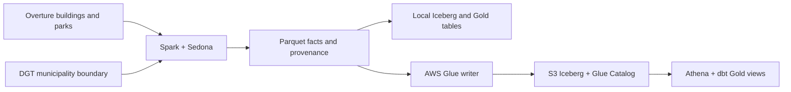

# European Urban Geography & Accessibility Platform

A batch geospatial lakehouse that measures mapped-building proximity to parks in
Coimbra, Portugal. It combines **PySpark, Apache Sedona and Apache Iceberg** with
an independently verified **AWS Glue → S3/Glue Catalog → Athena/dbt** deployment.

The project covers bounded data acquisition, spatial SQL, versioned tables,
repeatable publication, performance experiments, Terraform-managed infrastructure
and cross-engine validation. The AWS pilot has been completed and torn down;
this repository is source code for reproducing the workflows, not a hosted service.

## Verified pilot

The September 2026 Coimbra pilot produced the same result in local Spark,
independent Iceberg readback and Athena/dbt:

| Measure | Result |
| --- | ---: |
| Selected mapped buildings | 4,807 |
| Buildings within 500 m of a mapped park | 4,089 |
| Share within the threshold | 85.06% |
| dbt data tests | 7 passed |

The managed Glue replay returned `reused`: all 4,807 facts, the Iceberg snapshot
and stored files stayed unchanged. Both Gold view definitions were checked after
creation. The disposable AWS resources were removed and their absence verified.
Validation was run locally and against the approved AWS pilot; these results do
not claim production availability or large-scale cloud performance.

**Interpretation:** distance is measured from each building's point-on-surface to
a park polygon, in metres in Portugal TM06 (EPSG:3763), with an inclusive 500 m
threshold. Building counts are not population. This is straight-line proximity,
not walking access, residential classification or verification of public access.
A null distance means no candidate park was found within the threshold.

## Pipeline and tools



| Tool | Role |
| --- | --- |
| Python 3.11 / PySpark 3.5.6 | Bounded ingestion, transformations and execution control |
| Sedona 1.8.0 / Java 17 / Scala 2.12 | Projected geometry operations and spatial joins |
| Iceberg 1.10.2, table format v2 / Parquet | Snapshots, schema evolution, release history and analytical storage |
| AWS Glue 5.1 / S3 / Glue Catalog | Managed writer, object storage and shared table catalog |
| Athena engine 3 / dbt-athena | Gold SQL views, data tests and result comparison |
| Terraform 1.13.5 / AWS provider 6.19.0 | Dedicated trial infrastructure and IAM configuration |
| Docker / uv / pytest / Ruff / mypy | Runtime, locked dependencies and local validation |

Local tables use a filesystem Hadoop catalog. The AWS path uses S3 and the Glue
Catalog; Iceberg metadata tracks the Parquet data files in both cases. Gold SQL
is shared from [the SQL resources](src/urban_geography/sql/), rather than maintained
as separate copies for each engine. Coordination currently runs on Windows/Docker;
fully AWS-hosted scheduling is a future extension.

## Quickstart: no AWS account or datasets required

Use Docker Desktop with Linux containers on an amd64 machine. Local runs are
limited to two CPUs and 4 GiB; allow additional memory for Docker itself. Python,
Java and checksum-verified JARs are installed inside the image.

```sh
git clone https://github.com/edramosreis/urban-geography-platform.git
cd urban-geography-platform
docker compose build
docker compose run --rm pipeline urban-geo --help
docker compose run --rm pipeline pytest -q -m "not integration"
```

The build downloads pinned software dependencies. The tests use synthetic
fixtures and do not acquire geographic datasets or connect to AWS. No host
Python or Java installation is needed.

For a small Spark/Sedona integration check, including threshold edges, ties,
invalid geometries, boundary selection and an independent Shapely/PROJ oracle:

```sh
docker compose run --rm pipeline pytest -q tests/test_spatial.py
```

The `integration` marker identifies tests that require the Java/Spark runtime;
those tests still run without network acquisition. Run the complete suite with
`docker compose run --rm pipeline pytest -q`.

## Run the bounded real-data workflow

This section downloads public source data. The default configuration pins
Overture release `2026-09-23.1` and a small Coimbra rectangle. It allows at most
64 MiB transferred, 16 MiB extracted output and 20,000 features per kind. Inspect
[the configuration](configs/coimbra_pilot.json) before running it.

```sh
docker compose run --rm pipeline urban-geo run
```

Outputs include `artifacts/coimbra-pilot/summary.json`, building/grid Parquet,
`plan.txt` and Spark event logs. The completed raw extract and provenance are
retained under `data/raw/`. An upstream historical release may no longer be
available; the synthetic quickstart remains usable independently of that data.
A missing release is an error, not a reason to silently select another release
or widen the download budget.

Once the raw extract exists, reprocess it without another download:

```sh
docker compose run --rm pipeline urban-geo process --output artifacts/coimbra-replay
```

An optional pinned DGT municipality boundary intersects the rectangle. Boundary
acquisition is separately capped at 4 MiB:

```sh
docker compose run --rm pipeline python scripts/acquire_boundary.py
docker compose run --rm pipeline urban-geo process --boundary-config configs/coimbra_boundary.json --output artifacts/coimbra-boundary-pilot
```

Processing preserves full feature geometry across the selection boundary and
includes a conservative park halo. Duplicate keys or invalid geometry block
publication. Existing output paths are refused; choose a fresh path for a new run.
Consumers use completed manifests, not partially written staging directories.

### Local Iceberg and analytical workflows

After the boundary-selected processing run above:

```sh
docker compose run --rm pipeline python scripts/publish_iceberg.py --run artifacts/coimbra-boundary-pilot
docker compose run --rm pipeline python scripts/publish_release.py --run artifacts/coimbra-boundary-pilot
docker compose run --rm pipeline python scripts/report_grids.py --output artifacts/gold-grid-report.json
```

The first command publishes a single-run fact table. The second publishes to a
separate release-history table used by the SQL report. Replaying an identical
publication creates no new snapshot. Replacing a release requires an explicit
expected snapshot; older snapshots and unrelated release partitions are retained.
Schema evolution is explicit, and source-release, retrieval and processing times
remain distinct.

For additional retained-data workflows, start with these commands' `--help`:

| Entry point | Purpose |
| --- | --- |
| `scripts/compare_releases.py` | Compare two comparable retained releases |
| `scripts/evolve_history_schema.py` | Add the nullable processing-time field explicitly |
| `scripts/publish_dimensions.py` | Publish matched release/study-area records |
| `scripts/publish_gold.py` | Persist Gold grid summaries with fact/dimension lineage |
| `scripts/run_local_demo.py` | Verify the full path using two already retained releases |
| `scripts/benchmark_proximity.py` | Compare baseline, envelope and exact distance-join strategies |
| `scripts/profile_workload.py` | Describe geometry complexity and candidate workload |

The complete retained-data demo requires both configured extracts; a fresh clone
does not contain them. Performance experiments compare identical inputs and
semantics and retain task metrics and execution plans. The tested larger local
cohort contained 60,193 buildings and 54 parks. Same-host executor experiments do
not establish general multi-machine or cloud scaling.

## AWS workflow

The AWS pilot used frozen, checksum-verified Python/JAR/input releases, dedicated
writer/reader/builder roles, bounded job/query submission, live catalog readback
and saved receipts. Glue wrote the Iceberg fact table; Athena queried it and dbt
created the two Gold views and ran their data tests. The controllers supervise
owned executions and record uncertain outcomes rather than automatically retrying.

The quickstart neither deploys infrastructure nor runs paid jobs. A cloud
reproduction needs an AWS account, reviewed IAM and cost limits, prepared releases
and inputs, and a cleanup plan. Start with the source boundaries below; account
values in examples are synthetic.

| Area | Entry points |
| --- | --- |
| Infrastructure | [infra/aws](infra/aws/) |
| Runtime/release preparation | `scripts/prepare_glue_runtime.py`, `scripts/prepare_glue_release.py` |
| Managed writer | `scripts/glue_host_launcher.py`, `scripts/run_glue_s3_writer.py` |
| Independent fact reader / Athena | `scripts/athena_host_launcher.py`, `scripts/run_athena_pilot.py` |
| dbt project / Gold view controller | `scripts/prepare_dbt_project.py`, `scripts/dbt_host_launcher.py` |
| Cleanup and named-resource verification | `scripts/run_trial_cleanup.py`, `scripts/check_infrastructure_absence.py` |

The analytics/dbt environment has its own lock in [analytics/athena](analytics/athena/).
The ordinary pipeline image is not the complete analytics or managed Glue runtime.
Worker dependencies, SDK tooling and cloud execution have separate preparation
steps; local mocks are not substitutes for live IAM or engine verification.
The pilot is torn down, so cloud commands require a new deployment.

## Development and code navigation

```sh
docker compose run --rm pipeline ruff check .
docker compose run --rm pipeline ruff format --check .
docker compose run --rm pipeline mypy
```

- [src/urban_geography](src/urban_geography/): ingestion, geometry, storage and shared SQL.
- [scripts](scripts/): command entry points, operational controllers and verification tools.
- [tests](tests/): semantic, failure-path, provenance and publication checks.
- [configs](configs/): bounded study areas and local execution profiles.

A useful reading order is [config.py](src/urban_geography/config.py),
[cli.py](src/urban_geography/cli.py), [transform.py](src/urban_geography/transform.py),
[lakehouse.py](src/urban_geography/lakehouse.py), then
[the Gold SQL](src/urban_geography/sql/) and
[the dbt scaffold](analytics/athena/).
Dependency/JAR versions are pinned; operating-system updates during image builds
mean rebuilds are not claimed to be bit-for-bit identical.

## License and data attribution

Project code is licensed under [MIT](LICENSE). Upstream data and dependencies
retain their own licenses; MIT does not relicense them. Source datasets and
analytical output datasets are not distributed in this repository.

- © OpenStreetMap contributors, Overture Maps Foundation. Preserve upstream
  per-source attribution and consult [Overture's attribution and licensing](https://docs.overturemaps.org/attribution/)
  for the terms applicable to each source/theme and any derived database.
- DGT CAOP boundary attribution: “Informação geográfica cedida pela Direção-Geral
  do Território”. The retained acquisition includes official metadata and license
  evidence. See [DGT CAOP](https://www.dgterritorio.gov.pt/atividades/cartografia/cartografia-tematica/caop)
  and the pinned [boundary configuration](configs/coimbra_boundary.json).
